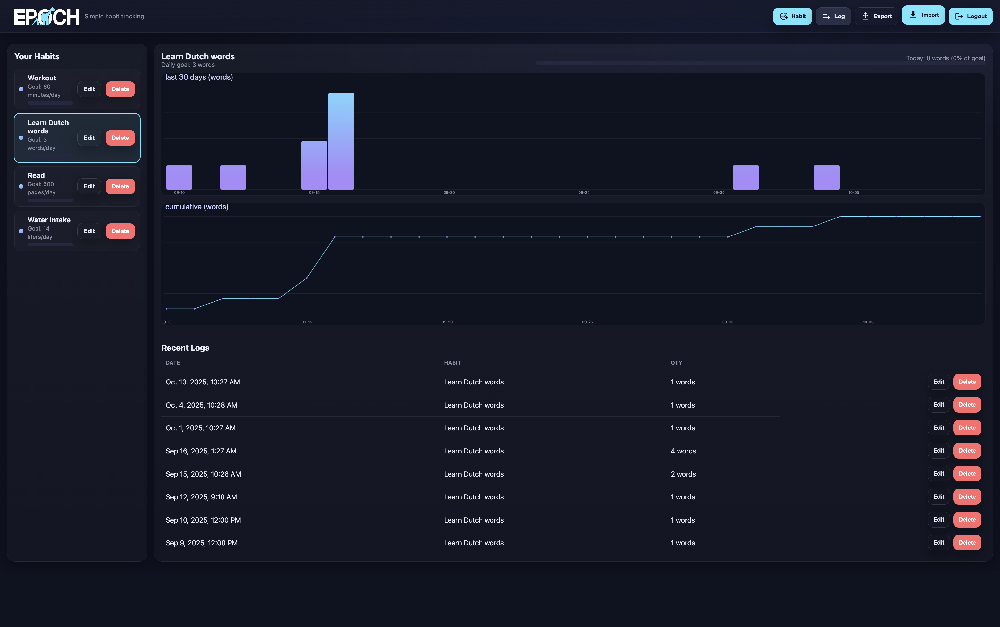
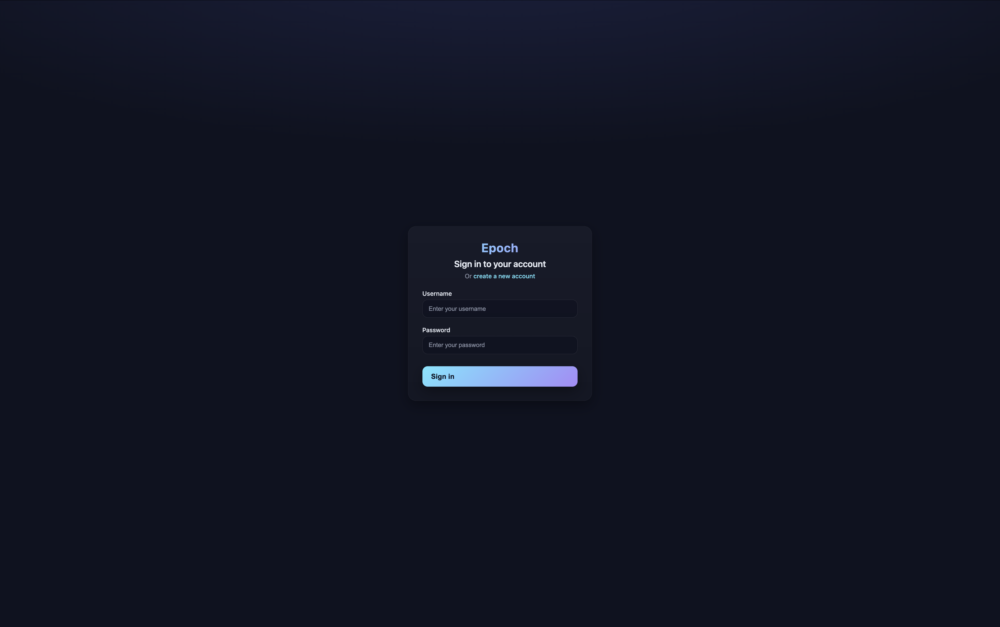
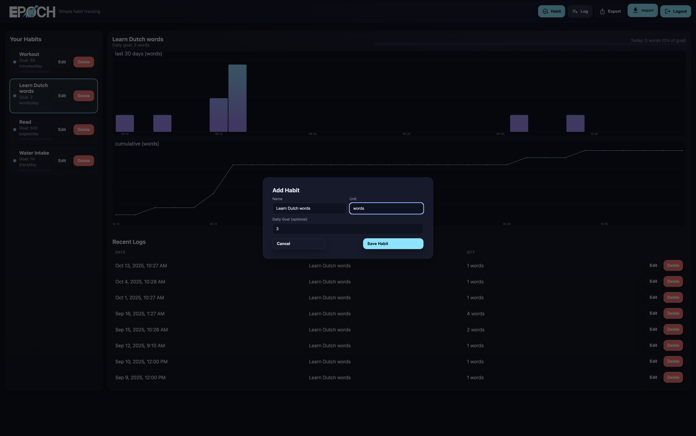
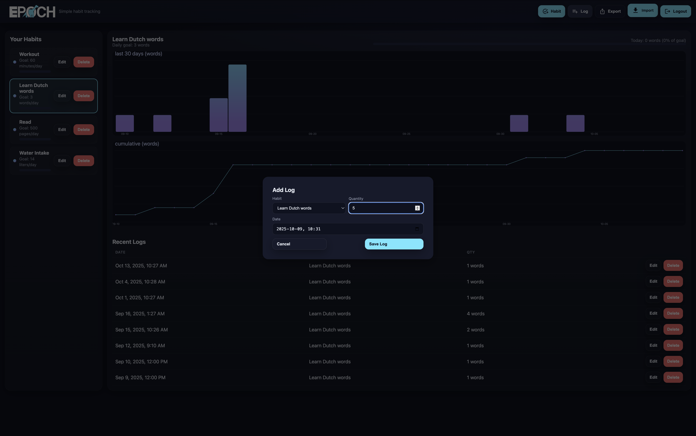
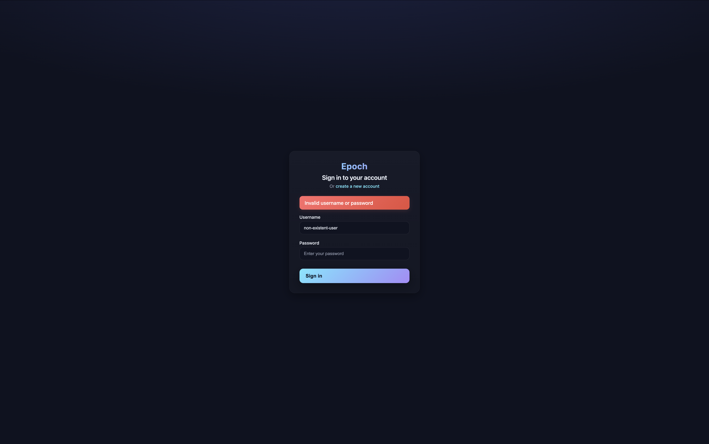

# Epoch

A habit tracking web application built with Go and PostgreSQL.



# Setup

## Development

The application uses:
- Go's `net/http` for routing
- PostgreSQL with session-based authentication
- Server-side rendered HTML templates for homepage, login, sign-up and sign-in 
- JavaScript for client interactions

Database connection details are configured via environment variables.
- For local development, use `sslmode=disable`.

## Building from Source

### Prerequisites
- PostgreSQL 16+
- Go 1.21+

### Database Setup

1. **Create PostgreSQL user and database:**
   ```bash
   # Connect as superuser (usually postgres)
   psql -U postgres
   
   # Create user and database
   CREATE USER epoch WITH PASSWORD 'epoch';
   CREATE DATABASE epoch OWNER epoch;
   \q
   ```

2. **Run schema migrations:**
   ```bash
   # Load the complete schema and sample data
   psql -U epoch -d epoch -f schema.sql
   ```

### Running Locally

1. **Set environment variables:**
   ```bash
   export DB_HOST=localhost
   export DB_PORT=5432
   export DB_USER=epoch
   export DB_PASSWORD=epoch
   export DB_NAME=epoch
   export DB_SSLMODE=disable
   ```

2. **Start the application:**
   ```bash
   go run cmd/web/main.go
   ```

   The app runs on **port 8080** by default. Access it at: http://localhost:8080

   To use a different port:
   ```bash
   go run cmd/web/main.go -port 3000
   ```

### Sample Users

The schema includes two test users:
- **Username:** `noah` **Password:** `pass`
- **Username:** `demo` **Password:** `pass`


### Docker Setup (in Progress)

#### Build Docker image

```bash
docker build -t myapp .
```

#### Run with environment overrides (optional)
```bash
docker run -p 8080:8080 \
  -e DB_HOST=127.0.0.1 \
  -e DB_PORT=5432 \
  -e DB_USER=epoch \
  -e DB_PASSWORD=devpass \
  -e DB_NAME=epoch \
  myapp
  ```

```bash
docker run --env-file .env -p 8080:8080 epoch
```

# Usage

### Create an account

To get started, sign up for a new account using your preferred credentials.
If you’re running the development build, you may use a preconfigured test account instead.




### Add a new Habit

Once logged in, create a new habit by selecting the “+” icon located in the top-right corner of the dashboard.
You can name the habit, set a frequency, and begin tracking your progress immediately.




### Add a new Log

To record your daily progress or updates, click the “+” icon in the top-right corner of the Logs page.
Each log entry will be associated with the corresponding habit for easy tracking.




### Account issues

If you encounter the following screen, it indicates an invalid username or password.
Please verify your credentials and try logging in again.




# Contributing

Contributions are welcome!

To report issues, request features, or suggest improvements:
1. Visit the [Issues](https://github.com/noahjalex/epoch/issues) page.
2. Provide a clear description and reproduction steps (if applicable).
3. I’ll review and respond as soon as possible.

If you’d like to contribute code:
1. Fork the repository
2. Create a new branch (git checkout -b feature/your-feature-name)
3. Commit and push your changes
4. Open a pull request with a clear description of your update

# License

**MIT License**
You’re free to use, modify, and distribute this software with attribution.
See the [LICENSE](./LICENSE) file for details.


# Credits

### Contributions

- Created and Maintained: [Noah Alexander](https://github.com/noahjalex)
- Logos and Branding: [Rob Bos](https://linkedin.com/in/rob-bos/)